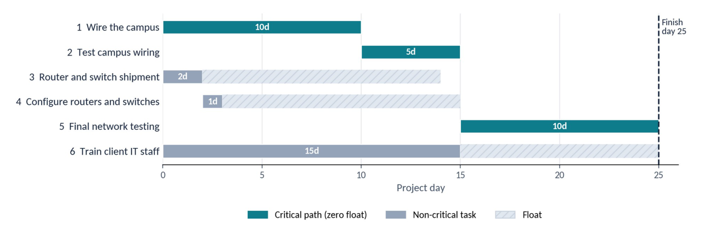

# Module 5 WBS Lab

*Critical path analysis and project scheduling charts for a new network setup*

**Course:** IT295 CompTIA Project+ Cert Prep &nbsp;·&nbsp; **Module:** 5 &nbsp;·&nbsp; **Type:** Lab

> The full assignment is rendered below. The original and a formal copy are available for download: [**Word document**](./IT295_Module5_WBS_Lab_Justin_Martin.docx) · [**PDF**](./IT295_Module5_WBS_Lab_Justin_Martin.pdf)

| Team Member | Baseline Duration | Critical Path |
| --- | --- | --- |
| Justin Martin | 25 days | Tasks 1 → 2 → 5 |

---

## A. Critical Path Analysis

### Baseline Schedule

| Task | Name | Days | Depends on | Start | Finish | Float | Critical |
| --- | --- | --- | --- | --- | --- | --- | --- |
| 1 | Wire the campus | 10 | None | 0 | 10 | 0 | **Yes** |
| 2 | Test connectivity of campus wiring | 5 | 1 | 10 | 15 | 0 | **Yes** |
| 3 | Shipment of routers and switches | 2 | None | 0 | 2 | 12 | No |
| 4 | Configuration of routers and switches | 1 | 3 | 2 | 3 | 12 | No |
| 5 | Final testing of network configuration | 10 | 2 and 4 | 15 | 25 | 0 | **Yes** |
| 6 | Training of client IT staff | 15 | None | 0 | 15 | 10 | No |

*Start and finish are project days. Float is how long a task can slip without delaying the project. Critical rows are shown in bold.*

**Figure 1 — Baseline Gantt Chart**

Original chart built from the assigned WBS.

### Baseline Questions

**1. What is the critical path for the project?**

**Tasks 1 → 2 → 5.** The critical path is Task 1, wiring the campus; Task 2, testing campus wiring; and Task 5, final network testing. These tasks total 25 days: 10 + 5 + 10.

**2. What is the minimum completion time?**

**25 days.** The minimum is 25 days. Tasks 3 and 4 finish in 3 days, and Task 6 finishes in 15 days. Both can run alongside the campus wiring work.

### What-If Scenarios

Each scenario starts from the original 25-day schedule. Changes from one scenario do not carry into the next.

#### Scenario 1: Training of client IT staff delayed 10 days

**3. If client IT staff training is delayed 10 days, how long is the overall delay?**

**No delay.** There is no overall project delay. Training originally takes 15 days and has 10 days of float, so a 10 day delay moves its completion to day 25.

**4. What happened to the critical path?**

**Two critical paths.** Tasks 1, 2, and 5 remain critical. Task 6 now also has zero float, creating a second critical path. Both paths finish on day 25.

#### Scenario 2: Wiring of the campus delayed 10 days

**5. If campus wiring is delayed 10 days, how long is the overall delay?**

**10 days, finishing on day 35.** The project is delayed 10 days and finishes on day 35. Tasks 2 and 5 must wait for the wiring work because they depend on it.

**6. What happened to the critical path?**

**Same path, now 35 days.** The critical path remains Tasks 1, 2, and 5, but its elapsed time increases from 25 to 35 days because of the wiring delay.

#### Scenario 3: Final testing of network configuration finishes 3 days early

**7. If final network testing finishes 3 days early, how much earlier can the project finish?**

**3 days earlier, on day 22.** The project can finish 3 days earlier, on day 22. Task 5 takes 7 days instead of 10, so the critical path becomes 10 + 5 + 7 = 22 days.

**8. What happened to the critical path?**

**Same path, now 22 days.** Tasks 1, 2, and 5 remain the critical path, with a shorter duration of 22 days. Training still finishes on day 15 and now has 7 days of float.

#### Scenario Summary

| Scenario | Project finish | Change | Critical path |
| --- | --- | --- | --- |
| Baseline | Day 25 | None | 1 → 2 → 5 |
| 1. Training delayed 10 days | Day 25 | No delay | 1 → 2 → 5 and 6 |
| 2. Wiring delayed 10 days | Day 35 | 10 days later | 1 → 2 → 5 |
| 3. Testing done 3 days early | Day 22 | 3 days earlier | 1 → 2 → 5 |

## B. Project Scheduling Charts

**1. What are Gantt charts used for?**

**Scheduling and tracking.** Gantt charts display project tasks as horizontal bars across a timeline. They show start and finish dates, durations, and overlapping work so the project manager can track progress and see when tasks should happen.

**2. What are PERT charts used for?**

**Dependencies and estimates.** PERT charts show the sequence of project tasks and the dependencies between them. They help identify the critical path and estimate completion time. PERT also uses optimistic, most likely, and pessimistic estimates to account for uncertainty in task durations.

### Side by Side

|  | Gantt chart | PERT chart |
| --- | --- | --- |
| Shows | Tasks as bars on a timeline | Tasks and dependencies as a network |
| Best for | Tracking progress against dates | Finding the critical path and estimating completion |
| Durations | One planned duration per task | Optimistic, most likely, and pessimistic estimates |

Figure 1 in Part A is a Gantt chart of this project.

## Outcome

I built a baseline schedule from the assigned WBS and found the 25-day critical path through Tasks 1, 2 and 5. I tested three what-if scenarios to show how float and task delays change the finish date and the critical path. I also compared Gantt and PERT charts and explained when each one is useful.
