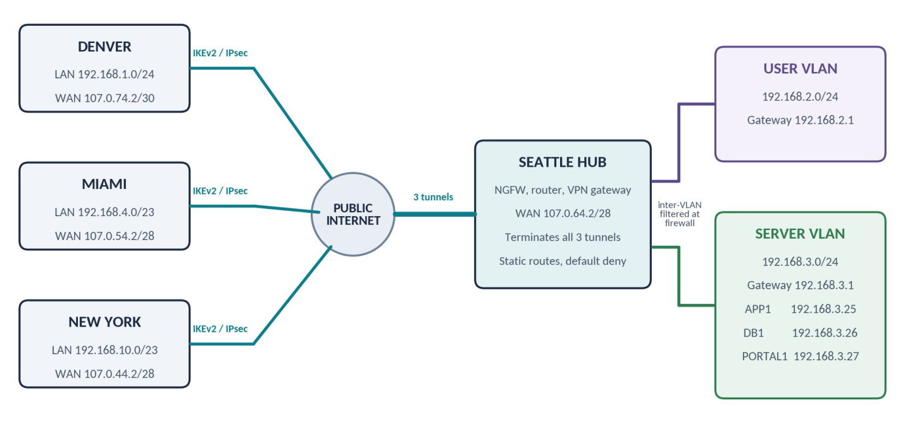

# Company ABC Network Design

*Hub-and-spoke IKEv2/IPsec WAN with segmented, least-privilege access to Seattle servers*

**Course:** IT490 Capstone - Cybersecurity & Networking &nbsp;·&nbsp; **Week:** 1 &nbsp;·&nbsp; **Type:** Report

> The full assignment is rendered below. The original and a formal copy are available for download: [**Word document**](./IT490_Week1_Company_ABC_Network_Design_Portfolio_Justin_Martin.docx) · [**PDF**](./IT490_Week1_Company_ABC_Network_Design_Portfolio_Justin_Martin.pdf)

| Sites | IPsec Tunnels | Seattle VLANs | Default-Deny Policy |
| --- | --- | --- | --- |
| 4 | 3 | 2 | 1 |

---

## Summary

Company ABC needed its Denver, Miami, and New York offices connected securely to the application, database, and portal servers in Seattle. I designed a hub-and-spoke IKEv2/IPsec WAN, corrected two /23 addressing errors in the scenario, split Seattle into user and server VLANs, and wrote a default-deny firewall policy so branch users reach only APP1 and PORTAL1 while DB1 stays behind the application. The design closes with a staged test plan to prove the tunnels, routing, and access rules work before users depend on them.

## Project Snapshot

|  |  |
| --- | --- |
| **Author** | Justin Martin |
| **Course** | IT 490 Capstone: Cybersecurity and Networking, Green River College |
| **Date** | September 21, 2026 |
| **Scope** | WAN design, IP addressing, site-to-site VPN, firewall policy, secure server access, and validation testing for a four-site company |
| **Skills demonstrated** | Subnetting and /23 boundary correction, IKEv2/IPsec tunnel design, static routing, NAT exemption, VLAN segmentation, least-privilege firewall rules, zero trust principles, test planning |
| **Standards referenced** | NIST SP 800-77 Rev. 1, NIST SP 800-207, NIST SP 800-41 Rev. 1 |

## 01. Design Overview

I would build a hub-and-spoke wide area network with Seattle as the central hub. Denver, Miami, and New York would each have one permanent point-to-point (site-to-site) IKEv2/IPsec tunnel to Seattle, which meets the requirement that every site connect to Seattle by point-to-point VPN. This design matches the scenario, keeps routing easy to understand, and provides encrypted communication over the public Internet. IPsec is appropriate because it protects traffic at the network layer between the participating sites (Barker et al., 2020).

Each location would use an ISP handoff, an edge next-generation firewall that also serves as the router and VPN gateway, and a managed switch for the local network. The public address supplied by the ISP would be assigned to the firewall WAN interface. The firewall LAN interface would be the default gateway for that site's devices.

### Addressing Plan

Two of the LAN entries need a small subnet correction. With a /23 mask, the third octet changes in blocks of two, so every /23 network has to start on an even third octet. This means Seattle's actual network is 192.168.2.0/23 and Miami's actual network is 192.168.4.0/23. The server addresses supplied in the scenario remain valid.

| Site | Correct LAN block | Usable host range | Local gateway |
| --- | --- | --- | --- |
| Denver | 192.168.1.0/24 | 192.168.1.1 to 192.168.1.254 | 192.168.1.1 |
| Seattle | 192.168.2.0/23 | 192.168.2.1 to 192.168.3.254 | VLAN gateways .2.1 and .3.1 |
| Miami | 192.168.4.0/23 | 192.168.4.1 to 192.168.5.254 | 192.168.4.1 |
| New York | 192.168.10.0/23 | 192.168.10.1 to 192.168.11.254 | 192.168.10.1 |

| Site | WAN interface | WAN subnet | Assumed ISP gateway |
| --- | --- | --- | --- |
| Denver | 107.0.74.2/30 | 107.0.74.0/30 | 107.0.74.1 |
| Seattle | 107.0.64.2/28 | 107.0.64.0/28 | 107.0.64.1 |
| Miami | 107.0.54.2/28 | 107.0.54.0/28 | 107.0.54.1 |
| New York | 107.0.44.2/28 | 107.0.44.0/28 | 107.0.44.1 |

> **Note:** The ISP gateway addresses are reasonable assumptions based on the listed subnets and must be confirmed with each provider before deployment. Seattle's range is shown as the full /23. Once it is split into two /24 VLANs in Section 03, each VLAN has its own network and broadcast address.

## 02. Network Topology

**Figure 1 — Company ABC hub-and-spoke VPN topology**

### How the Sites Will Connect

Seattle would terminate all three tunnels on its edge firewall. Each branch firewall would use Seattle's public address, 107.0.64.2, as its VPN peer. Because the tunnels are route-based, the static routes decide which traffic enters each tunnel, and the protected networks below define what each tunnel is allowed to carry. Static routes are enough for this small design and are easier to troubleshoot than a dynamic routing protocol.

| Tunnel | Local protected network | Seattle peer | Remote protected network |
| --- | --- | --- | --- |
| Denver to Seattle | 192.168.1.0/24 | 107.0.64.2 | 192.168.2.0/23 |
| Miami to Seattle | 192.168.4.0/23 | 107.0.64.2 | 192.168.2.0/23 |
| New York to Seattle | 192.168.10.0/23 | 107.0.64.2 | 192.168.2.0/23 |

### Router, Firewall, and VPN Configuration

1. **WAN and LAN interfaces.** Assign the ISP address to each firewall WAN interface and the local gateway address to its LAN interface.
2. **Tunnels.** Configure one route-based IKEv2/IPsec tunnel from each branch to Seattle. Use AES-256-GCM encryption, certificate authentication, perfect forward secrecy, and automatic rekeying.
3. **Tunnel health.** Enable dead peer detection so a failed tunnel is noticed and rebuilt quickly. Set TCP MSS clamping on the tunnel interfaces so the extra IPsec overhead does not cause fragmentation.
4. **Routing.** Add a route at each branch for 192.168.2.0/23 through its tunnel. Add return routes at Seattle for the Denver, Miami, and New York LANs.
5. **NAT exemption.** Create NAT exemption rules so private traffic keeps its original address inside the VPN. Regular Internet traffic would still use source NAT through the local ISP connection.
6. **Intersite policy.** Allow only the required intersite traffic. Branch-to-branch traffic would be denied unless a later business need is approved.

## 03. Secure Access to the Seattle Servers

I would divide Seattle's /23 into a user VLAN and a server VLAN. The user VLAN would use 192.168.2.0/24. The server VLAN would use 192.168.3.0/24, which contains APP1, DB1, and PORTAL1. Inter-VLAN traffic would pass through the Seattle firewall so that the same access rules and logging apply to local and remote users. This follows the principle that access should be based on the user, device, and resource instead of assuming that any internal connection is trusted (Rose et al., 2020).

| Resource | Address | Permitted access | Security control |
| --- | --- | --- | --- |
| APP1 | 192.168.3.25 | Authorized users on TCP 443 | HTTPS with a trusted TLS certificate |
| DB1 | 192.168.3.26 | APP1 on the required database port | TLS, service account, and no general user access |
| PORTAL1 | 192.168.3.27 | Authorized users on TCP 443 | HTTPS, role-based access, and MFA |

The scenario says end users will connect to DB1 as well as APP1 and PORTAL1. I would meet that requirement by having users reach DB1's data through APP1 instead of opening the database port to every branch. That keeps the database off the user network and puts the application's authentication and logging in front of every query. If a team later needs direct database access, such as a reporting tool, I would allow only that group's systems on the database port with TLS and individual database accounts, never shared credentials.

### Access Process

1. **Request.** A user at a branch requests APP1 or PORTAL1 by an internal DNS name, resolved by an internal DNS server reachable over the tunnel. The request is routed to the site's firewall and enters the encrypted tunnel to Seattle.
2. **Policy check.** The Seattle firewall confirms that the source subnet, destination server, and service are allowed. It then forwards the session to the server VLAN.
3. **Authentication.** APP1 and PORTAL1 require HTTPS. Users authenticate with individual accounts, role-based permissions, and multifactor authentication where supported.
4. **Database isolation.** Ordinary users do not connect directly to DB1. APP1 connects to DB1 through a specific firewall rule using an encrypted database protocol and a dedicated service account. Database administrators would use a hardened management workstation or jump host.
5. **Logging and defense in depth.** The firewall records successful and denied connections and forwards them to a central log platform such as OpenSearch for review and alerting. Intrusion prevention, endpoint protection, patching, and account lockout policies provide additional layers of defense.

### Firewall Policy Summary

| Source | Destination | Service | Action |
| --- | --- | --- | --- |
| Approved branch users | APP1 192.168.3.25 | HTTPS TCP 443 | Allow and log |
| Approved branch users | PORTAL1 192.168.3.27 | HTTPS TCP 443 | Allow and log |
| APP1 192.168.3.25 | DB1 192.168.3.26 | Required DB port with TLS | Allow and log |
| Approved admin host | DB1 192.168.3.26 | Encrypted admin access | Allow and log |
| Any other intersite source | Seattle server VLAN | Any | Deny and log |

A default deny rule at the end of the policy keeps access limited to known business requirements. Firewall rules should be documented, reviewed, and tested as part of an overall firewall policy (Scarfone & Hoffman, 2009).

## 04. Testing and Validation

I would test the design in stages before users rely on it. The goal is to prove that the required traffic works, the traffic is encrypted, and anything outside the approved policy is blocked.

| # | Test area | Pass criteria |
| --- | --- | --- |
| 1 | WAN and tunnels | Each WAN interface reaches its ISP gateway and all three IKEv2/IPsec security associations are active. |
| 2 | Routing | From a test system at every branch, routes to APP1 and PORTAL1 exist and each site uses the VPN instead of the public Internet. |
| 3 | Application access | APP1 and PORTAL1 open over HTTPS, the certificate is trusted, the expected user authentication is required, and unauthorized accounts are rejected. |
| 4 | Database isolation | A normal user cannot connect directly to DB1. APP1 and the approved administrator path reach only the required database service. |
| 5 | Deny rules and logging | Branch-to-branch sessions and unapproved ports are denied. Both allowed and blocked events are visible in the firewall logs. |
| 6 | Documentation | Final routes, firewall rules, certificates, recovery procedures, and configuration backups are documented after the tests pass. |

## 05. Future Enhancements

Seattle is a single point of failure in this design. If the hub firewall or its ISP link goes down, every branch loses access to the servers. For a production rollout I would add a second firewall in a high-availability pair and a secondary ISP circuit at Seattle, with backup tunnels that fail over automatically. If Company ABC adds more sites, I would move from static routes to BGP or OSPF over the tunnels, since static routes get harder to manage as the network grows. I would also build SIEM alerts for repeated denied connections to the server VLAN and failed VPN negotiations.

## 06. Conclusion

The proposed design gives every branch a direct encrypted connection to the Seattle hub while keeping the server environment separated from user devices. The addressing plan corrects the /23 boundaries, the routing is simple enough for the size of the company, and the firewall policy limits each connection to what is actually needed. Users can reach APP1 and PORTAL1 securely, while DB1 remains protected behind the application and approved administration paths.

## References

Barker, E., Dang, Q., Frankel, S., Scarfone, K., & Wouters, P. (2020). *Guide to IPsec VPNs* (NIST Special Publication 800-77, Revision 1). National Institute of Standards and Technology. https://doi.org/10.6028/NIST.SP.800-77r1

Rose, S., Borchert, O., Mitchell, S., & Connelly, S. (2020). *Zero trust architecture* (NIST Special Publication 800-207). National Institute of Standards and Technology. https://doi.org/10.6028/NIST.SP.800-207

Scarfone, K., & Hoffman, P. (2009). *Guidelines on firewalls and firewall policy* (NIST Special Publication 800-41, Revision 1). National Institute of Standards and Technology. https://doi.org/10.6028/NIST.SP.800-41r1

## Outcome

I designed a hub-and-spoke IKEv2/IPsec WAN that connects three branch offices to the Seattle hub over route-based tunnels. I corrected two /23 addressing errors in the scenario and split Seattle into user and server VLANs. I wrote a default-deny firewall policy that keeps DB1 behind APP1 and planned staged tests to prove the tunnels, routing, and access rules before users rely on them.
