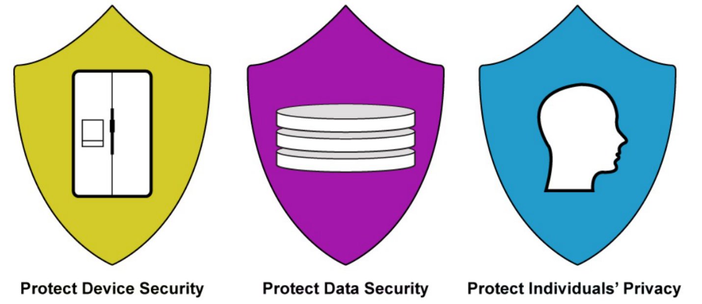

# NIST IR 8228

*Managing IoT Cybersecurity and Privacy Risks*

**Course:** IT490 Capstone - Cybersecurity & Networking &nbsp;·&nbsp; **Week:** 4 &nbsp;·&nbsp; **Type:** Presentation

> The full assignment is rendered below. The original and a formal copy are available for download: [**PowerPoint presentation**](./IT490_Week4_NIST_IR_8228_Justin_Martin.pptx) · [**PDF**](./IT490_Week4_NIST_IR_8228_Justin_Martin.pdf)

| Presenter | Course | Date |
| --- | --- | --- |
| Justin Martin | IT 490 Capstone   Week 4 | October 12, 2026 |

---

## Slide 1: NIST IR 8228

Managing IoT Cybersecurity and Privacy Risks

Device · Data · Privacy

## Slide 2: What NIST IR 8228 Covers

A June 2019 NIST report that helps organizations assess cybersecurity and privacy risks for individual IoT devices throughout their lifecycles.

- **IoT devices connect digital systems to the physical world**
  Sensors collect measurements. Actuators change physical conditions. Network interfaces connect devices to other systems.
- **The report supports existing risk management**
  Organizations use it to identify gaps in their current practices and adapt controls to each device and its purpose.

*Boeckl et al. (2019), §1 and §2*

## Slide 3: Why IoT Changes Risk Management

- **Physical effects**
  A compromised lock or temperature controller can disrupt operations. Security changes also need to respect safety and availability.
- **Different management options**
  Some devices lack familiar administration tools, useful logs, or a way to install endpoint security software.
- **Uneven security and privacy capabilities**
  Update support and access controls vary. A device may need protections outside the device itself.

*Boeckl et al. (2019), §3.1–§3.3*

## Slide 4: Cybersecurity and Privacy Risks

| Cybersecurity | Privacy |
| --- | --- |
| Protects devices and data against compromise. | Examines how processing personal information can harm people, including authorized use. |
| **Example:** An attacker steals recordings or takes control of a connected camera. | **Example:** A company keeps employee movement records for an unnecessary purpose. |

**Strong encryption protects records, but it does not decide whether collecting those records is appropriate.**

*Boeckl et al. (2019), §3*

## Slide 5: The Three Risk Mitigation Goals

**Figure 4 — Risk Mitigation Goals**

Boeckl et al. (2019), §4, Figure 4, p. 11

Device security prevents misuse of the device. Data security protects information. Privacy addresses the effects of processing information about people.

## Slide 6: Use Across the Device Lifecycle

1. **Before purchase**
   Identify the purpose, device owner, data collected, and vendor support period. Confirm that required protections are available.
2. **During operation**
   Apply approved configurations, restrict access, monitor available logs, and manage updates around operational needs.
3. **At retirement**
   Remove credentials and network access. Erase stored data and address copies held in vendor services according to retention rules.

*Boeckl et al. (2019), §5.1–§5.2*

## Slide 7: Company ABC IoT Scenario

Seattle and Denver add connected security cameras and badge readers. The devices support building security and send records to a managed service.

- **Device risk**
  Unauthorized access could change camera settings or interfere with building access.
- **Data risk**
  Video and badge records can expose employee identities and movement patterns.
- **Privacy risk**
  Even authorized access can create problems if staff use records beyond their approved purpose.

*Original scenario applying Boeckl et al. (2019), §§3–5*

## Slide 8: Controls for Company ABC

| Risk area | Example control | Evidence to review |
| --- | --- | --- |
| Device security | Isolate devices and restrict management access | Inventory, access rules, update records |
| Data security | Encrypt transfers and limit access to stored records | Configuration and access logs |
| Privacy | Limit collection, retention, and approved uses | Data map and retention policy |
| Vendor dependency | Review support terms and remote access | Support dates and vendor agreement |

These examples depend on the devices and business requirements. They are not a universal checklist.

*Illustrative controls applying Boeckl et al. (2019), §4 and §5*

## Slide 9: Ownership and Risk Decisions

- **Business and facilities teams**
  Explain what each device must do and which operational disruptions the organization can tolerate.
- **IT and security teams**
  Track devices, assess technical limitations, and maintain controls that fit the environment.
- **Privacy and procurement teams**
  Review personal information processing and vendor commitments. Assign an accountable owner for unresolved risk.

*Boeckl et al. (2019), §5*

## Slide 10: What I Take From the Report

**A connected device needs an owner and a risk decision.**

For Company ABC, the first step is understanding what each device does and where its data goes. That gives the organization a basis for choosing controls and deciding whether the remaining risk is acceptable.

The same review continues when device use, vendor support, or business needs change.

*Boeckl et al. (2019), §5*

## Slide 11: References

Boeckl, K., Fagan, M., Fisher, W., Lefkovitz, N., Megas, K. N., Nadeau, E., Piccarreta, B., O’Rourke, D. G., & Scarfone, K. (2019). *Considerations for managing Internet of Things (IoT) cybersecurity and privacy risks* (NISTIR 8228). National Institute of Standards and Technology. https://doi.org/10.6028/NIST.IR.8228

### Illustration credits

Slide 5. Figure 4, Risk Mitigation Goals. From *Considerations for managing Internet of Things (IoT) cybersecurity and privacy risks* (p. 11), by K. Boeckl et al., 2019, National Institute of Standards and Technology (https://doi.org/10.6028/NIST.IR.8228). In the public domain.

Icons. Font Awesome Free by Fonticons, Inc., licensed under CC BY 4.0. https://fontawesome.com/license/free

Company ABC examples and slide layouts are original applications of the report.

## Outcome

I summarized how NIST IR 8228 frames IoT risk around device security, data security and individual privacy, and why connected devices need different handling than ordinary IT assets. I applied the report to a Company ABC scenario with cameras and badge readers, then matched each risk area to example controls, review evidence and accountable owners across the device lifecycle.
