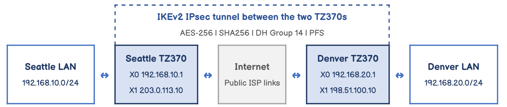

# Company ABC Seattle to Denver VPN

*Site-to-site IPsec VPN with SonicWall TZ370*

**Course:** IT490 Capstone - Cybersecurity & Networking &nbsp;·&nbsp; **Week:** 4 &nbsp;·&nbsp; **Type:** Discussion post

> The full assignment is rendered below. The original and a formal copy are available for download: [**Discussion post (HTML)**](./sonicwall_vpn_discussion_post.html) · [**PDF**](./IT490_Week4_SonicWall_VPN_Discussion_Justin_Martin.pdf) · [**Original figure (PNG)**](./Figure1_Seattle_Denver_VPN_topology.png)

---

For Company ABC, I selected a SonicWall TZ370 for both the Seattle and Denver offices and designed a site to site IPsec VPN using IKEv2. The goal was to give employees secure access to approved resources at the other branch over the internet. This scenario assumes modest traffic requirements and static public IP addresses. The walkthrough describes the configuration for the scenario; the final section covers validation to perform before deployment.

**Figure 1 — Seattle to Denver site to site VPN topology**

Original diagram created for this post.

## 1. Establish the addressing plan

I assigned the following example addresses to keep the two branch networks distinct:

| Setting | Seattle | Denver |
| --- | --- | --- |
| WAN address | 203.0.113.10 | 198.51.100.10 |
| WAN subnet mask | 255.255.255.0 | 255.255.255.0 |
| ISP gateway | 203.0.113.1 | 198.51.100.1 |
| LAN network | 192.168.10.0/24 | 192.168.20.0/24 |
| LAN gateway (X0) | 192.168.10.1 | 192.168.20.1 |

The WAN addresses are documentation examples. An actual deployment would use public addresses, subnet masks, and gateways supplied by each ISP. I chose different private networks so the branches would not have overlapping addresses.

## 2. Complete the initial firewall setup

I started with SonicWall's setup guidance, connecting an administrator's computer to the X0 LAN port and opening https://192.168.168.168. From there, I signed in with the initial credentials, changed the administrator password, completed the setup wizard, and registered each appliance with MySonicWall. A supported firmware release and a configuration backup belong in the preparation process before deployment. The menu paths below follow SonicOS 7.

## 3. Configure the LAN and WAN interfaces

Next, I configured X0 with each branch's LAN gateway and X1 with its WAN address, subnet mask, and ISP gateway under **Network > System > Interfaces**. Seattle used 192.168.10.1 on X0, and Denver used 192.168.20.1. Each branch firewall served as the default gateway for its local computers.

I restricted HTTPS firewall administration to approved administrator computers. Before moving on to the VPN, internet connectivity needs to be confirmed at both offices so an ISP or interface issue does not get mistaken for a tunnel problem.

## 4. Create the network address objects

Under **Object > Match Objects > Addresses**, I created a Network object for the remote branch and assigned it to the VPN zone. On Seattle's firewall, Denver_LAN represented 192.168.20.0 with mask 255.255.255.0. On Denver's firewall, Seattle_LAN represented 192.168.10.0 with the same mask. The existing X0 Subnet object on each firewall identified its local network.

## 5. Create Seattle's VPN policy

To build Seattle's policy, I opened **Network > IPsec VPN > Rules and Settings**, enabled VPN, and selected **Add**. I chose **Site to Site** as the policy type and **IKE using Preshared Secret** as the authentication method.

I named the policy Seattle_to_Denver and entered 198.51.100.10 as the IPsec Primary Gateway. Authentication required the same long, randomly generated shared secret on both firewalls, entered securely. On the **Network** tab, I selected Seattle's X0 Subnet as the local network and Denver_LAN as the destination network.

## 6. Configure matching security proposals

On the **Proposals** tab, I selected **IKEv2 Mode** and configured the following security settings:

| Setting | IKE (Phase 1) | IPsec (Phase 2) |
| --- | --- | --- |
| Protocol | IKEv2 | ESP |
| Encryption | AES-256 | AES-256 |
| Authentication | SHA256 | SHA256 |
| Diffie-Hellman | Group 14 | PFS with Group 14 |
| Lifetime | 28,800 seconds | 3,600 seconds |

I matched these proposals on both firewalls so the peers could negotiate the connection. The settings reflect the security choices for this scenario rather than simply accepting every default.

## 7. Configure Denver's matching policy

I repeated the policy setup on Denver's firewall, naming it Denver_to_Seattle. This time, the remote gateway was Seattle's WAN address, 203.0.113.10. Denver's X0 Subnet became the local network, and Seattle_LAN became the destination network.

| Policy setting | Seattle firewall | Denver firewall |
| --- | --- | --- |
| Policy name | Seattle_to_Denver | Denver_to_Seattle |
| Primary gateway | 198.51.100.10 | 203.0.113.10 |
| Local network | X0 Subnet | X0 Subnet |
| Destination network | Denver_LAN | Seattle_LAN |

The Denver policy used the same shared secret and security proposals as Seattle. Under **Advanced**, I bound both policies to the WAN zone and left unnecessary broadcast and firewall management options disabled. SonicWall's IKEv2 guidance recommends Keep Alive on at least one side; where the firmware exposes that option in IKEv2 mode, Seattle is the designated side.

## 8. Control which traffic can cross the tunnel

To control access across the tunnel, I selected **Suppress automatic Access Rules creation for VPN Policy**. I then defined explicit rules under **Policy > Rules and Policies > Access Rules** for approved LAN to VPN and VPN to LAN traffic on each firewall.

For the example HTTPS connection, I allowed an approved Seattle workstation to reach a Denver application server and added the corresponding receiving rule in Denver. Connections initiated from Denver require their own approved rules. Temporary ICMP rules can support testing. I left **Apply NAT Policies** disabled because the branch networks do not overlap.

## 9. Validate and document the connection

Validation starts by generating traffic between approved test computers and checking for an active tunnel. The next checks are to test the actual application, confirm that traffic counters increase, and verify that an unapproved connection is blocked. These checks establish whether the configuration works as intended; no measured test results are included in this walkthrough.

If the tunnel does not establish, the first items to check are the peer addresses, shared secret, proposals, and network selections. If the tunnel connects but applications fail, troubleshooting moves to access rules, endpoint firewalls, gateways, and DNS. Once validation is complete, the final configurations and test results should be saved for future troubleshooting.

For me, a successful setup means more than seeing an active tunnel. Seattle and Denver should be able to use the resources they need while access remains limited to what Company ABC has approved.

## References

SonicWall. (n.d.). *TZ270/TZ270W, TZ370/TZ370W, and TZ470/TZ470W quick start guide*. https://www.sonicwall.com/techdocs/pdf/tz270-370-470-series-quick-start-guide.pdf

SonicWall. (n.d.). *SonicOS 7.1 IPsec VPN administration guide: Site to site VPN policies using a preshared key*. https://www.sonicwall.com/support/technical-documentation/docs/sonicos-7-1-ipsec_vpn/Content/site-to-site-vpns-policies-create-preshared-key.htm

SonicWall. (2022, October 12). *How can I setup site to site VPN with IKE2?*. https://www.sonicwall.com/support/knowledge-base/how-can-i-setup-site-to-site-vpn-with-ike2/kA1VN0000000GKy0AM

SonicWall. (n.d.). *How to stop the creation of auto-added access rules and enable the ability to edit or delete the existing rules?*. https://www.sonicwall.com/support/knowledge-base/how-to-stop-the-creation-of-auto-added-access-rules-and-enable-the-ability-to-edit-or-delete-the-existing-rules/kA1VN0000000HNS0A2

Figure 1 is my own diagram based on my addressing plan. No external illustrations were used.

## Outcome

I designed a site to site IKEv2 IPsec VPN between Company ABC's Seattle and Denver offices using SonicWall TZ370 firewalls. I built the addressing plan, address objects, and mirrored VPN policies with matching Phase 1 and Phase 2 proposals on both sides. I suppressed the automatic access rules so that only approved traffic could cross the tunnel, and I outlined the validation and troubleshooting checks to run before deployment.
