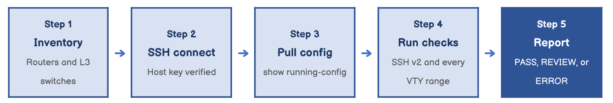

# Company ABC Cisco Configuration Checker

*Network automation with Python and Netmiko*

**Course:** IT490 Capstone - Cybersecurity & Networking &nbsp;·&nbsp; **Week:** 5 &nbsp;·&nbsp; **Type:** Script and discussion post

> The full assignment is rendered below. The original and a formal copy are available for download: [**Discussion post (HTML)**](./config_checker_discussion_post.html) · [**Python script**](./cisco_config_checker.py) · [**PDF**](./IT490_Week5_Cisco_Config_Checker_Discussion_Justin_Martin.pdf)

---

For company ABC, I would use Python with the Netmiko library to check the configurations on our Cisco routers and Layer 3 switches. Logging into every device individually would take time, and it would be easy to overlook a setting. A script makes the process more consistent and helps identify devices that need attention.

My script connects to each device through SSH, retrieves its running configuration, and checks a basic remote management baseline. It looks for SSH version 2 and checks each VTY line range for SSH access and local authentication. For this example, I am assuming ABC uses local user accounts rather than centralized AAA authentication.

**Figure 1 — How the script processes each device**

Original diagram created for this post.



If a device fails at any step, the script reports an error and moves on to the next device.

## What the script checks

| Check | PASS when the configuration contains |
| --- | --- |
| SSH version | ip ssh version 2 |
| VTY configuration | At least one line vty section |
| Each VTY range: SSH only | transport input ssh |
| Each VTY range: local authentication | login local |

## The script

```python
import re
from getpass import getpass
from netmiko import ConnectHandler

# Example inventory: replace with all ABC routers and Layer 3 switches.
devices = {
    "SEA-R01": "192.168.16.1",
    "SEA-SW01": "192.168.16.2",
    "SEA-SW02": "192.168.16.3",
}

username = input("Username: ")
password = getpass("SSH password: ")
enable_secret = getpass("Enable secret, if required: ")

for name, address in devices.items():
    print(f"\n--- {name} ({address}) ---")

    try:
        with ConnectHandler(
            device_type="cisco_ios",
            host=address,
            username=username,
            password=password,
            secret=enable_secret,
            ssh_strict=True,
            system_host_keys=True,
            conn_timeout=10,
        ) as connection:
            if not connection.check_enable_mode():
                connection.enable()

            config = connection.send_command(
                "show running-config", read_timeout=30
            )

        if not config.strip() or re.search(r"^%.*", config, re.M):
            raise ValueError("Could not retrieve a valid configuration.")

        checks = {
            "SSH version 2": bool(
                re.search(r"^ip ssh version 2\s*$", config, re.M)
            )
        }

        vty_sections = list(re.finditer(
            r"^(line vty[^\n]*)\n((?:[ \t]+[^\n]*\n?)*)",
            config,
            re.M,
        ))

        checks["VTY configuration found"] = bool(vty_sections)

        for section in vty_sections:
            label, settings = section.groups()
            commands = {line.strip() for line in settings.splitlines()}
            checks[f"{label}: SSH only"] = (
                "transport input ssh" in commands
            )
            checks[f"{label}: local authentication"] = (
                "login local" in commands
            )

        for setting, passed in checks.items():
            status = "PASS" if passed else "REVIEW"
            print(f"{status}: {setting}")

    except Exception as error:
        print(f"ERROR: Device check incomplete: {error}")
```

## Running it

Before running the script, I would install Netmiko using python3 -m pip install netmiko and replace the example inventory with ABC’s actual device addresses. Each device would need SSH enabled, an authorized account with permission to view the running configuration, and a verified host key saved in my known_hosts file. The script prompts for passwords instead of storing them in the code.

## Reading the results

Each setting receives a PASS or REVIEW result. Checking every VTY section matters because one range could allow SSH while another still permits other access methods. If a device cannot be reached or its configuration cannot be retrieved, the script reports an error and continues checking the remaining devices.

## Limits

This script collects information without changing the device configurations. A REVIEW result means the setting needs investigation against ABC’s approved baseline. It is not a complete security assessment, and a device using centralized AAA would require different authentication checks. I would test the script in a lab before using it across the company’s network.

## References

Byers, K. (n.d.). *Netmiko API documentation*. https://ktbyers.github.io/netmiko/docs/netmiko/index.html

Byers, K. (n.d.). *Netmiko examples*. https://github.com/ktbyers/netmiko/blob/develop/EXAMPLES.md

Figure 1 is my own diagram. The script is my own work built from the Netmiko documentation above.

## Outcome

I wrote a Python script that uses Netmiko to connect to Company ABC's Cisco routers and Layer 3 switches over SSH with host key verification. It pulls each running configuration and checks for SSH version 2 and for SSH only access with local authentication on every VTY range. Each setting gets a PASS or REVIEW result, and unreachable devices are reported as errors without stopping the run.
