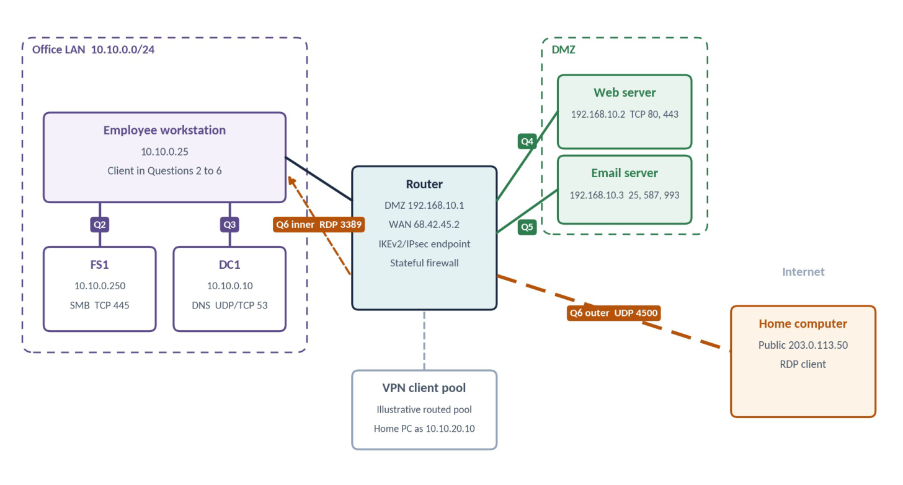

# Ports and Services Traffic Analysis

*Company ABC network communications and five tuple examples*

*Service identification, request and response traffic, and remote access through a VPN.*

**Course:** IT490 Capstone - Cybersecurity & Networking &nbsp;·&nbsp; **Week:** 5 &nbsp;·&nbsp; **Type:** Report

> The full assignment is rendered below. The original and a formal copy are available for download: [**Word document**](./IT490_Week5_Ports_Services_Five_Tuples_Portfolio_Justin_Martin.docx) · [**PDF**](./IT490_Week5_Ports_Services_Five_Tuples_Portfolio_Justin_Martin.pdf)

| Service Ports Mapped | Traffic Paths | Five Tuples | VPN Layers Shown |
| --- | --- | --- | --- |
| 11 | 5 | 22 | 2 |

---

## Executive Overview

Company ABC needs service specific access between its LAN, DMZ and remote users. Client connections normally use a temporary source port and the server’s listening port. Replies reverse those endpoints. For remote work, the VPN carries the connection to the office computer, while the public router receives the encrypted tunnel traffic.

## Report Details

| Field | Detail |
| --- | --- |
| Prepared by | Justin Martin |
| Course | IT 490 Week 5 |
| Date | October 18, 2026 |
| Report type | Scenario analysis based on the assigned network. Traffic examples illustrate expected communications and are not packet capture results. |

## 00. Scenario and analysis approach

**Figure 1 — Company ABC topology with the traffic path for each question.**

Original diagram based on the assigned addresses. The VPN pool and home address are examples.

### Assigned Environment

| Network or asset | Address | Role |
| --- | --- | --- |
| Office LAN | `10.10.0.0/24` | Single company location |
| Employee workstation | `10.10.0.25` | Client used in Questions 2 through 6 |
| FS1 | `10.10.0.250` | File server |
| DC1 | `10.10.0.10` | Domain controller and DNS server |
| DMZ router interface | `192.168.10.1` | Gateway for the DMZ |
| Web server | `192.168.10.2` | HTTP and HTTPS services |
| Email server | `192.168.10.3` | Mail services in the DMZ |
| Router WAN interface | `68.42.45.2` | Public endpoint |

### How to Read the Five Tuples

| 1 | 2 | 3 | 4 | 5 |
| --- | --- | --- | --- | --- |
| Source IP | Source port | Destination IP | Destination port | Protocol |

Tuple order throughout this report: source IP, source port, destination IP, destination port, protocol. The protocol is TCP or UDP, not the application name. For example, HTTPS is the service, while TCP identifies the transport used in the HTTPS examples.

In the tuple tables, → marks a client request and ← marks the server’s response. Protocol is shown in blue for TCP and teal for UDP.

### Assumptions and Observation Points

FS1 uses SMB. The chosen client ports are illustrative dynamic ports, not fixed requirements. LAN to DMZ routing preserves the client address. The web and mail examples show traffic at the internal interfaces, before any public address translation. The remote access example explicitly assumes an IKEv2/IPsec VPN terminating on the router and a routed VPN client pool.

The scenario does not specify the VPN product, LAN gateway address, DMZ mask or enabled mail protocols. No values for those details are treated as observed configuration.

## 1 Commonly used service ports

The following ports identify common service endpoints. ABC should permit the protocols it actually deploys and limit access by source, destination and business need. [1, 2, 3]

| Service | Protocol and port | Use at company ABC |
| --- | --- | --- |
| File sharing | TCP 445 | SMB access to FS1 |
| DNS | UDP 53 and TCP 53 | Queries to DC1. TCP also supports responses requiring TCP and other DNS operations. |
| Web | TCP 80 | HTTP access to the DMZ web server |
| Secure web | TCP 443 | HTTPS using TLS over TCP |
| Secure web with HTTP/3 | UDP 443 | QUIC based HTTPS if the server supports HTTP/3. [6] |
| Remote Desktop | TCP 3389 and UDP 3389 | RDP to the employee’s office computer over the VPN |
| SMTP relay | TCP 25 | Mail transfer between mail servers |
| Mail submission | TCP 587 or TCP 465 | Authenticated submission. Require STARTTLS on 587 or implicit TLS on 465. |
| IMAP | TCP 143 or TCP 993 | Mailbox access. 993 uses implicit TLS. 143 requires STARTTLS for protected access. |
| POP3 | TCP 110 or TCP 995 | Mailbox retrieval. 995 uses implicit TLS. 110 requires STLS for protected access. |
| IKEv2/IPsec VPN | UDP 500 and UDP 4500 | IKE negotiation and NAT traversal in the assumed VPN example. [4] |

### Port and Protocol Distinctions

A registered port does not prove that the expected application is running or that the traffic is safe. Verification requires configuration review, logs or authorized traffic inspection. Legacy NetBIOS file sharing can also use UDP 137 and 138 plus TCP 139, but modern direct SMB uses TCP 445. [1, 2]

The client’s temporary port distinguishes simultaneous sessions. The examples use ports in the IANA dynamic/private range of 49152 through 65535. Actual client choices vary by operating system and configuration. [1]

For IPsec without UDP encapsulation, ESP uses IP protocol 50 and has no TCP or UDP ports. It cannot be described by a conventional TCP/UDP port pair. [4]

## 2 and 3 File sharing and DNS traffic

### 2 Workstation to FS1

For an SMB session, 10.10.0.25 connects from example port 51000 to FS1 at 10.10.0.250 on TCP 445. The response returns to the same client port. [2]

| Traffic | Source IP | Src port | Destination IP | Dst port | Protocol |
| --- | --- | --- | --- | --- | --- |
| → SMB request | `10.10.0.25` | 51000 | `10.10.0.250` | 445 | TCP |
| ← SMB response | `10.10.0.250` | 445 | `10.10.0.25` | 51000 | TCP |

Both hosts are on 10.10.0.0/24. With ordinary local switching, this traffic stays on the LAN and does not pass through the router’s WAN or DMZ firewall. Host firewall rules or internal segmentation controls would govern access at those points.

### 3 Workstation to DC1 DNS

A typical DNS query uses UDP destination port 53. The TCP example is a separate connection, such as a retry after a truncated UDP response. DNS supports both transports, and clients can also use TCP directly. [2]

| Traffic | Source IP | Src port | Destination IP | Dst port | Protocol |
| --- | --- | --- | --- | --- | --- |
| → DNS query | `10.10.0.25` | 52000 | `10.10.0.10` | 53 | UDP |
| ← DNS reply | `10.10.0.10` | 53 | `10.10.0.25` | 52000 | UDP |
| → DNS over TCP | `10.10.0.25` | 52001 | `10.10.0.10` | 53 | TCP |
| ← TCP reply | `10.10.0.10` | 53 | `10.10.0.25` | 52001 | TCP |

### Interpretation

Replies use source port 53 because DC1 is the DNS service endpoint. The workstation receives the answer on the temporary port it selected. A TCP connection and a UDP exchange remain different flows even if their IP addresses and port numbers match.

These tuples cover SMB and DNS only. Domain logon, Kerberos, LDAP and other Active Directory dependencies are outside the requested examples and would need separate policy review.

## 4 and 5 Web and email traffic

### 4 Workstation to the DMZ Web Server

The internal client reaches 192.168.10.2 through the router. HTTP and HTTPS use separate sessions. These examples assume HTTPS over TCP rather than HTTP/3. [1, 6]

| Traffic | Source IP | Src port | Destination IP | Dst port | Protocol |
| --- | --- | --- | --- | --- | --- |
| → HTTP request | `10.10.0.25` | 53000 | `192.168.10.2` | 80 | TCP |
| ← HTTP response | `192.168.10.2` | 80 | `10.10.0.25` | 53000 | TCP |
| → HTTPS request | `10.10.0.25` | 53001 | `192.168.10.2` | 443 | TCP |
| ← HTTPS response | `192.168.10.2` | 443 | `10.10.0.25` | 53001 | TCP |

### 5 Workstation to the DMZ Email Server

Email includes several services. The tuples below show SMTP on 25 for completeness, authenticated submission on 587, and IMAP over TLS on 993. For normal employee sending, ABC should prefer authenticated submission with required TLS. [1, 3]

| Traffic | Source IP | Src port | Destination IP | Dst port | Protocol |
| --- | --- | --- | --- | --- | --- |
| → SMTP request | `10.10.0.25` | 54000 | `192.168.10.3` | 25 | TCP |
| ← SMTP response | `192.168.10.3` | 25 | `10.10.0.25` | 54000 | TCP |
| → Mail submission | `10.10.0.25` | 54001 | `192.168.10.3` | 587 | TCP |
| ← Submission reply | `192.168.10.3` | 587 | `10.10.0.25` | 54001 | TCP |
| → IMAPS request | `10.10.0.25` | 54002 | `192.168.10.3` | 993 | TCP |
| ← IMAPS response | `192.168.10.3` | 993 | `10.10.0.25` | 54002 | TCP |

The SMTP 25 example assumes ABC explicitly permits that client connection. Port 587 does not itself guarantee encryption. The server must require STARTTLS. If ABC uses 465 or 995 instead, substitute that destination port and reverse it in the response.

The public address 68.42.45.2 does not replace the private DMZ server address in these internal examples. External connections would depend on ABC’s destination NAT rules and the observation point. [5]

## 6 Remote Desktop from home through the VPN

Assume the home internet connection uses documentation address 203.0.113.50. The router at 68.42.45.2 terminates IKEv2/IPsec, and the VPN assigns the home computer 10.10.20.10 from an illustrative routed pool. The pool has a return route from the LAN and does not use source NAT toward the workstation. [4]

### Internet Side of the Encrypted Tunnel

After NAT traversal begins, an example home NAT mapping changes source port 4500 to 62000. The company WAN sees UDP 4500 VPN traffic, with the following outer tuples. [4]

| Traffic | Source IP | Src port | Destination IP | Dst port | Protocol |
| --- | --- | --- | --- | --- | --- |
| → VPN inbound | `203.0.113.50` | 62000 | `68.42.45.2` | 4500 | UDP |
| ← VPN return | `68.42.45.2` | 4500 | `203.0.113.50` | 62000 | UDP |

### Inside the VPN After Decryption

The RDP connection uses the assigned VPN address as its source and 10.10.0.25 as its destination. TCP 3389 is the primary example. UDP 3389 may carry additional RDP traffic if supported and permitted. [2]

| Traffic | Source IP | Src port | Destination IP | Dst port | Protocol |
| --- | --- | --- | --- | --- | --- |
| → RDP connection | `10.10.20.10` | 55000 | `10.10.0.25` | 3389 | TCP |
| ← RDP response | `10.10.0.25` | 3389 | `10.10.20.10` | 55000 | TCP |
| → RDP UDP traffic | `10.10.20.10` | 55001 | `10.10.0.25` | 3389 | UDP |
| ← RDP UDP reply | `10.10.0.25` | 3389 | `10.10.20.10` | 55001 | UDP |

### Policy and Verification

Allow authorized VPN users to reach approved workstations on the required RDP ports. Keep public TCP and UDP 3389 closed. Apply DMZ permissions to the specific servers and services, with default denial for other traffic. A stateful firewall can associate return traffic with permitted sessions. [5]

Verify the design using a VPN connection log, firewall session records and an authorized capture on the LAN side. Confirm the assigned client address, successful RDP access and rejection of public RDP attempts. No live testing was performed for this scenario.

A different VPN product or a gateway that translates VPN client addresses would produce different outer or inner tuples. The encrypted WAN packet does not expose the inner RDP port pair.

## References

[1] Internet Assigned Numbers Authority. (2026). *Service Name and Transport Protocol Port Number Registry*. https://www.iana.org/assignments/service-names-port-numbers

[2] Microsoft. (n.d.). *Service overview and network port requirements for Windows*. Microsoft Learn. https://learn.microsoft.com/en-us/troubleshoot/windows-server/networking/service-overview-and-network-port-requirements

[3] Moore, K., & Newman, C. (2018). *Cleartext considered obsolete: Use of Transport Layer Security (TLS) for email submission and access* (RFC 8314). IETF. https://www.rfc-editor.org/rfc/rfc8314.html

[4] Kaufman, C., Hoffman, P., Nir, Y., Eronen, P., & Kivinen, T. (2014). *Internet Key Exchange Protocol Version 2 (IKEv2)* (RFC 7296), Section 2.23. IETF. https://www.rfc-editor.org/rfc/rfc7296.html

[5] Scarfone, K., & Hoffman, P. (2009). *Guidelines on firewalls and firewall policy* (NIST SP 800-41 Rev. 1), Sections 2 and 4. National Institute of Standards and Technology. https://doi.org/10.6028/NIST.SP.800-41r1

[6] Bishop, M. (Ed.). (2022). *HTTP/3* (RFC 9114). IETF. https://www.rfc-editor.org/rfc/rfc9114.html

Sources accessed October 18, 2026. Host addresses come from the assignment. Client source ports, the home public address, the VPN pool and the NAT mapping are labeled examples. Figure 1 is an original diagram.

## Outcome

I mapped the common service ports Company ABC relies on and wrote request and response five tuples for SMB, DNS, web, email and Remote Desktop traffic. I showed how a client's temporary port pairs with the server's listening port and how replies reverse those endpoints. For remote access, I separated the encrypted UDP 4500 tunnel seen on the WAN from the RDP session inside the VPN.
